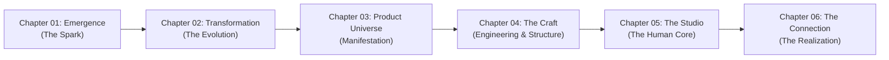

# MINDLE — THE ORGANIC DIGITAL JOURNEY
## Stage 1: Master Creative Direction & Implementation Storyboard

> **Brand**: Mindle (AI-Powered Product Studio)  
> **Website**: [mindle.in](https://mindle.in)  
> **Creative Thesis**: *From a Spark to Something Extraordinary* — A single organic sculptural form emerges from darkness and evolves across six interconnected chapters, embodying the transformation of an ambitious idea into intelligent, enduring digital products.

---

## 1. Executive Concept & Visual Metaphor

Instead of disjointed section animations or generic tech clichés (particle swarms, tangled wireframe spheres, floating cards, or purple neon gradients), the entire Mindle website is unified by a **single living organic entity**.



### The Metaphor: *The Living Artifact*
1. **The Seed**: A nascent, fluid droplet suspended in void — pure potential.
2. **The Unfolding**: Under the kinetic energy of scrolling, the droplet expands into layered, fluid ribbon manifolds that breathe and morph.
3. **The Manifestation**: The fluid form bifurcates and anchors real digital products (GitaConnect, Panchatantra AI), framing high-resolution product viewports.
4. **The Crystalline Precision**: Fluid curves align into structured, faceted architectural lattices representing deep engineering, AI guardrails, and system design.
5. **The Calm Horizon**: The sculpture reclines into an ambient, reflective horizon backdrop, shifting the focus to the human team and philosophy.
6. **The Continuous Loop**: The form resolves into a Mobius-like sculptural monument with a gravitational draw toward collaboration.

---

## 2. Six-Chapter Storyboard & Spatial Choreography

```
+-------------------------------------------------------------------------------------------------------+
| SCENE 01: EMERGENCE            SCENE 02: TRANSFORMATION       SCENE 03: PRODUCT UNIVERSE             |
|                                                                                                       |
|      ( * )                           ( ( @ ) )                     [GitaConnect]       [Panchatantra] |
|   Single fluid droplet           Expanding organic ribbons            \                     /         |
|   Liquid chrome + glass core     Tension, depth & philosophy           ( Fluid Anchor Manifolds )     |
|   "Ideas deserve to become..."   "Technology can be human"             Interactive product portals    |
+-------------------------------------------------------------------------------------------------------+
| SCENE 04: THE CRAFT            SCENE 05: THE STUDIO           SCENE 06: THE CONNECTION               |
|                                                                                                       |
|      /| \  / |\                     ___ . --- . ___                  \                  /             |
|     /_|__\/__|_\                   (  Team Gallery  )                 \   ( O )        /              |
|   Precision faceted lattices     Calm ambient horizon sculpture        \  Pure Loop   /               |
|   Interactive capability nodes   Co-founders, ethos & craft             "Let's make it real"          |
+-------------------------------------------------------------------------------------------------------+
```

### Chapter 01 — EMERGENCE (*The Spark*)
* **Timeline / Duration**: 5–8 second intro choreography on first visit (with an immediate, accessible `[Skip Intro]` control and persistent session memory).
* **Environment**: Deep void (`#050505`) with subtle procedural film grain and an ACES Filmic tonemapped directional key light.
* **3D Choreography**:
  * The Mindle wordmark appears through a sharp editorial mask reveal.
  * A single, undulating organic sculpt emerges from negative space: an amorphous liquid-chrome shell encasing a translucent glass core with subtle chromatic dispersion.
  * Camera slowly pushes in from `Z = 12.0` to `Z = 8.5`, rotating 4° on the Y-axis.
* **Typography & Narrative**:
  * Eyebrow: `AI PRODUCT STUDIO · INDIA / EVERYWHERE` (Monospace, uppercase, tracking `0.24em`).
  * Display Headline: `"Ideas deserve to become extraordinary products."`
  * Action: Secondary magnetic navigation anchor to explore the journey or initiate dialogue.
* **Scroll Transition**: As the user begins scrolling, the form reacts with a ripple wave across its surface geometry.

### Chapter 02 — TRANSFORMATION (*The Evolution*)
* **Scroll Dynamics**: Scroll progress scrubs the continuous parametric evolution.
* **3D Choreography**:
  * The single droplet splits and extrudes into fluid ribbons that gently coil and unwrap along an invisible 3D spline.
  * Internal refractive glass elements catch grazing light as the form breathes.
  * Camera drifts downward and dollies slightly right to open a generous editorial reading column on the left.
* **Typography & Narrative**:
  * Editorial Headline: `"Technology can be deeply human."`
  * Philosophy: Explains Mindle's product-first thesis: building enduring systems with genuine utility.
  * 3 Pillars displayed in an asymmetric editorial grid:
    1. *Useful before impressive*
    2. *Intelligence with boundaries*
    3. *Craft survives launch day*
* **Micro-interactions**: Pointer movement gently modulates the ribbon wave amplitude via a damped spring physics curve.

### Chapter 03 — PRODUCT UNIVERSE (*Manifestation*)
* **Scroll Dynamics**: The ribbons widen and create two distinct focal spatial nodes.
* **3D Choreography**:
  * Node A (GitaConnect): The upper ribbon forms an elegant curved cradle holding the GitaConnect flagship iOS viewport (700 verses, 11 languages, offline-first datastore, AI spiritual mentor, digital Jaap haptics).
  * Node B (Panchatantra AI): The lower ribbon coils into an adaptive learning portal showcasing the adaptive moral reasoning engine and voice narration framework.
  * Camera glides between Node A and Node B on scroll with cinematic easing.
* **Interactive Behavior**:
  * Hovering over a product node rotates the 3D cradle to face the camera directly, illuminating internal edge-lighting.
  * Integrated authentic assets: High-resolution screenshots (`/gitaconnect-app.jpg`, `/Photo1.png`–`/Photo3.png`, `/panchatantra-kids.jpg`).
  * Direct CTAs: TestFlight Beta invitation & detailed case study route `/products/[slug]`.
* **Zero Fabrications**: Strictly presents real product stats (700 verses, 140 mantras, 11 Indian languages, patent-pending architecture).

### Chapter 04 — THE CRAFT (*Engineering & Structure*)
* **Scroll Dynamics**: Pin/scrub interactive section. The organic curves morph into precision-faceted, mathematically ordered geometries (representing applied AI, system architecture, and full-stack discipline).
* **3D Choreography**:
  * The fluid surface tightens into clean, polygonal facets reminiscent of raw obsidian and liquid titanium.
  * Refractions shift from soft Gaussian blur to crisp prismatic caustic glints.
* **Interactive System (No Generic Cards)**:
  * An interactive **Discipline Dial / Spatial Selector**:
    * `01 / AI Development` (RAG, LLM guardrails, eval harnesses)
    * `02 / SaaS Platforms` (Multi-tenant, typed architectures, Stripe/Supabase)
    * `03 / Web Applications` (Next.js, reactive states, zero-latency rendering)
    * `04 / Mobile Apps` (Swift, offline-first sync, haptic micro-interactions)
    * `05 / Intelligent Automation` (Self-healing workflows, data pipelines)
  * Selecting any discipline sends an impulse pulse through the 3D structure, highlighting the corresponding geometric subsystem and updating live technical specs.

### Chapter 05 — THE STUDIO (*The Human Core*)
* **Scroll Dynamics**: The visual pace calms; the 3D geometry gently reclines into the background as an ambient, monolithic landscape horizon.
* **Visual Mood**: Warm studio editorial, generous negative space, high contrast typography.
* **Content & People**:
  * Introduces the co-founders with authentic photography and specific roles:
    * **Abhinav Kumar** (Co-Founder · End-to-end engineering)
    * **Abhijit Balpande** (Co-Founder · Design & product craft)
    * **Omkar Pujeri** (Co-Founder · Systems, offline architecture & AI pipelines)
    * **Aryan Dev** (Co-Founder · Applied AI & domain-locked models)
  * Values & Operating Model: High-trust, product-first ownership, durable code over ephemeral services.
* **3D Interaction**: Ambient camera drift with subtle parallax responding to mouse coordinates.

### Chapter 06 — THE CONNECTION (*Realization*)
* **Scroll Dynamics**: The horizon sculpture converges into an infinity loop / Mobius monument of polished chrome.
* **Typography & Narrative**:
  * Headline: `"Have an idea? Let's make it real."`
  * Subtext: *"Whether exploring an early concept or scaling an intelligent product, we build with conviction."*
* **Interactive Elements**:
  * Integrated frictionless inquiry trigger (`/contact`).
  * Minimalist architectural footer: exact brand logo proportions, social coordinate links, legal routes, and time-zone telemetry (`India / 24.8°N`).

---

## 3. Visual Language, Materials & Lighting

### Color Palette
| Token | Hex | Role |
| :--- | :--- | :--- |
| `void` | `#050505` | Background canvas base |
| `surface-dark` | `#0a0a0a` | Secondary depth planes |
| `metal-dark` | `#171717` | Structural chrome shadows |
| `metal-light` | `#e2e2df` | Specular highlights on chrome |
| `glass-tint` | `#ffffff` | Refractive transmittance |
| `text-primary` | `#ffffff` | Primary editorial display headings |
| `text-muted` | `#8e8e8a` | Body narratives and explanations |
| `text-faint` | `#484845` | Monospace indexes, coordinates, rules |

### Materials Specification (R3F / Three.js)
1. **Liquid Chrome (`MeshStandardMaterial` / `MeshPhysicalMaterial`)**:
   * `metalness`: `0.96`
   * `roughness`: `0.06`
   * `clearcoat`: `1.0`
   * `clearcoatRoughness`: `0.08`
   * Environment map reflection intensity: `1.4`
2. **Frosted Translucent Glass (`MeshTransmissionMaterial`)**:
   * `transmission`: `0.88`
   * `thickness`: `0.65`
   * `roughness`: `0.05`
   * `chromaticAberration`: `0.025`
   * `distortion`: `0.12`
   * `distortionScale`: `0.2`
   * `samples`: `10` (optimized for 60fps)
3. **Soft Matte Sculptural Core**:
   * `color`: `#0f0f0f`
   * `roughness`: `0.6`
   * `metalness`: `0.2`
   * Subtle subsurface scattering illusion via Fresnel edge rim lighting.

### Studio Lighting Setup
* **Key SpotLight**: `position: [5, 8, 7]`, intensity: `45`, angle: `0.38`, penumbra: `0.85`, color: `#ffffff` (casts soft directional shadows).
* **Fill SpotLight**: `position: [-6, 2, 4]`, intensity: `14`, angle: `0.5`, penumbra: `1.0`, color: `#c8c8c4`.
* **Rim PointLight**: `position: [0, -3, -4]`, intensity: `18`, color: `#ffffff` (delineates silhouetted curves from background void).
* **Volumetric Ambient**: Soft cone light shaft with procedural dust/fog falloff (`fog: #050505, near: 6, far: 24`).

---

## 4. Typography System

* **Display Font**: Custom geometric / editorial sans with negative tracking (`tracking-[-0.07em]`), tight line-height (`leading-[0.88]–[0.92]`), using responsive `clamp()` rules.
* **Body Font**: Highly legible neutral grotesque sans (`Inter`), high contrast against dark backgrounds (`text-white/60` to `text-white/90`).
* **Technical Monospace Font**: JetBrains Mono / Geist Mono for chapter coordinates, metadata labels, status tags, and telemetry indices (`text-[10px]`, `tracking-[0.24em]`, `uppercase`).

---

## 5. Technical Architecture & Performance Budget

```
+-------------------------------------------------------------------------+
| Single Shared Master WebGL Canvas (Fixed Fullscreen Viewport)          |
|  - R3F Canvas with Adaptive DPR [1.0, 1.6]                              |
|  - Shared Scene, Camera & Lighting Rig                                  |
|  - Single unified OrganicSculpture mesh (custom GLSL simplex noise)     |
+-------------------------------------------------------------------------+
                                    |
            ScrollTrigger / GSAP / Framer Motion Scrubber
                                    |
+-------------------------------------------------------------------------+
| HTML Chapter Overlay (Z-Index: 10, pointer-events-none where ambient)   |
|  - Chapter 01: Emergence (Hero + Skip Intro)                           |
|  - Chapter 02: Transformation (Manifesto + Pillars)                    |
|  - Chapter 03: Product Universe (Interactive Viewports)                |
|  - Chapter 04: The Craft (Discipline Dial & Live Blueprints)           |
|  - Chapter 05: The Studio (Founders & Ethos)                            |
|  - Chapter 06: The Connection (CTA & Telemetry Footer)                 |
+-------------------------------------------------------------------------+
```

### Performance Engineering
1. **Single WebGL Context**: No mounting/unmounting canvases between sections. A single persistent `<Canvas>` handles all 6 chapters smoothly without context-loss or memory leaks.
2. **GPU Vertex Shader Displacement**: The organic morphing is calculated in vertex shaders (GLSL simplex noise with time and scroll offsets) rather than heavy JavaScript CPU geometry updates or giant morph target files.
3. **Adaptive Quality Tiering**:
   * Desktop Retina: `dpr: [1, 1.6]`, shadow map 1024, bloom enabled.
   * Mobile / Low-power: `dpr: 1.0`, shadows disabled, transmission samples reduced, bloom bypassed.
   * `prefers-reduced-motion`: Canvas static sculptural angle without motion scrub, direct editorial layout.
4. **No Scrolljacking**: Native browser scrolling remains 100% natural and fluid. Scroll progress drives virtual timeline scrubbing without capturing wheel events or trapping the cursor.

---

## 6. Implementation Stages Roadmap

| Stage | Milestone | Key Deliverables |
| :--- | :--- | :--- |
| **Stage 1** | **Creative Direction & Storyboard** | Complete 6-chapter specification, visual & technical architecture *(Present Stage)*. |
| **Stage 2** | **3D Prototype** | Dedicated parametric organic sculpt component with custom noise shader, liquid chrome & glass materials, cinematic camera rig, and interactive gesture controls. |
| **Stage 3** | **Homepage Experience** | Complete 6-chapter narrative assembly on `src/app/page.tsx` integrating the 3D sculpt, ScrollTrigger choreography, real products (GitaConnect & Panchatantra), craft dial, and studio gallery. |
| **Stage 4** | **Sub-routes & Cohesion** | Unify `/about`, `/products`, `/products/[slug]`, `/services`, `/contact` with the identical cinematic visual language, shared tokens, and smooth page transitions. |
| **Stage 5** | **Validation & Tuning** | Rigorous verification across 60fps performance benchmarks, mobile responsiveness, Lighthouse scores, and zero console warnings. |
